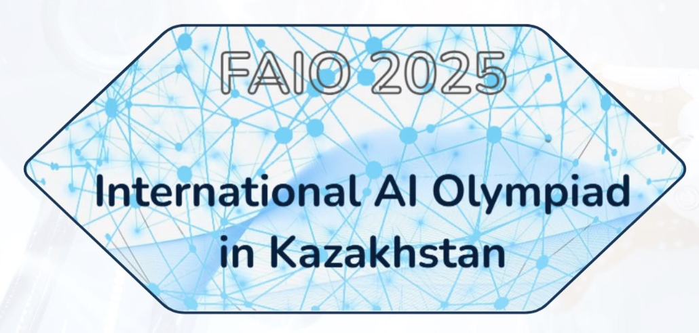

<!-- DOCTOC SKIP -->

<h1 align="center">
  
   FAIO 2024
</h1>

  🎓 1st edition — statements in three languages, figures, scorers and the original contest export.

  
  
  

---

### 🧠 Qualification
- 📘 **Readme:** [Open](./qualification/README.md)
- 🔗 **Original contest:** [contest.yandex.ru/contest/71291](https://contest.yandex.ru/contest/71291/problems)
- ⚠️ The 2024 qualification export was never provided, so only the round notes are here.

---

### 🏆 Finals (Main Competition)
- 📘 **Round readme:** [English](./final/README.md) · [Қазақша](./final/README.kz.md) · [Русский](./final/README.ru.md)
- 🔗 **Original contest:** [contest.yandex.ru/contest/69765](https://contest.yandex.ru/contest/69765/problems)

**Problems:**
[A — Math Test Results](./final/a-math-test-results/) ·
[B — The Story of a Meteorologist](./final/b-meteorologist/) ·
[C — Radioactive Decay](./final/c-radioactive-decay/) ·
[D — K-means](./final/d-kmeans/) ·
[E — Text Classification](./final/e-text-classification/) ·
[F — SVM](./final/f-svm/)

---
## What is in each problem folder

| | |
| --- | --- |
| `en.md` · `kz.md` · `ru.md` | The statement as it ran on contest.faio.kz. |
| `assets/` | The statement's figures. |
| `checker/` | The real scorer — the same code the platform runs. |
| `original/` | The untouched source the problem was migrated from — the Yandex Contest export, with the statement HTML per language. |
| `README.md` | Scoring, provenance, and what is and isn't here. |

Not published: answer keys, the participant data archives, and real participant
submissions. Data is downloadable from the link in each statement. Two FAIO 2026
scorers are withheld because they embed live grading secrets — each says so in place.

**Upsolve any of it at [contest.faio.kz](https://contest.faio.kz).**

---

## Other years
- [FAIO 2026](https://github.com/faio-official/faio-2026)
- [FAIO 2025](https://github.com/faio-official/faio-2025)
- [All FAIO repositories](https://github.com/faio-official)

---

## 👥 Credits
### Organizers | Jury | Authors

  
  
  
  
  
  
  
  
  
  
  
  
  
  
  

---

  Part of <a href="https://github.com/faio-official">FAIO Tasks</a> · Licensed under <a href="./LICENSE">Apache-2.0</a>

