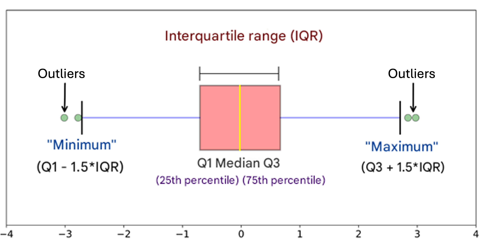
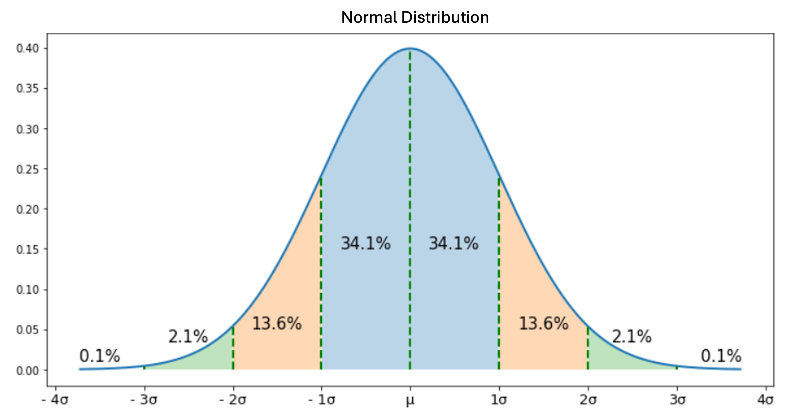

Adilkhan is a senior meteorologist working at Kazhydromet in Almaty. He frequently sends his intern, Darkhan, to the T1-Tuyuksu meteorological station to measure ice purity. The T1-Tuyuksu station is located far from the city, and getting there takes about two hours. Because of this, Darkhan disliked going there and sometimes just took ice from his refrigerator, recording its purity as if it were data from the meteorological station. This went on for the past 12 months. One day, Adilkhan noticed an unusual ice purity value in the data provided by Darkhan. When Adilkhan found out about the deception, he fired Darkhan. To avoid losing a year’s worth of data, Adilkhan wants to identify and remove outliers from the dataset. Since he is not well-versed in mathematics, he asks you to develop an algorithm for detecting outliers.

Outlier detection is the process of identifying data points that significantly differ from other observations in a dataset. Outliers can arise for various reasons, including measurement errors, unusual events, or fraudulent activities. Detecting outliers is a critically important task because they can skew statistical analyses and disrupt the functioning of machine learning models. Identifying and removing them helps improve model quality and prediction accuracy. Some popular methods for outlier detection include:

- Interquartile Range (IQR) Method: IQR is calculated as the difference between the 75th (Q3) and 25th (Q1) percentiles of the data. Q1 is the data point located precisely in the middle of the lower half of the dataset. Q3 is the point halfway between the median and the end of the dataset. Observations that fall outside the range $\text{Q1} - 1.5 \times \text{IQR}$ and $\text{Q3} + 1.5 \times \text{IQR}$ are considered outliers.
- Z-Score Method: This method is used for data that follows a normal distribution. Outliers are identified as observations that deviate from the mean by more than a specified number of standard deviations (usually 2-3 standard deviations).

 

Your task is to implement an Interquartile Range (IQR) algorithm and output a list of outliers in a single line.

**Input Format:**

A line contains $N$ ice purity values separated by spaces:

1.5 5 7.9 100000 -250999.67

**Output Format:**

A line with $K$ outlier values separated by spaces:

100000 -250999.67
