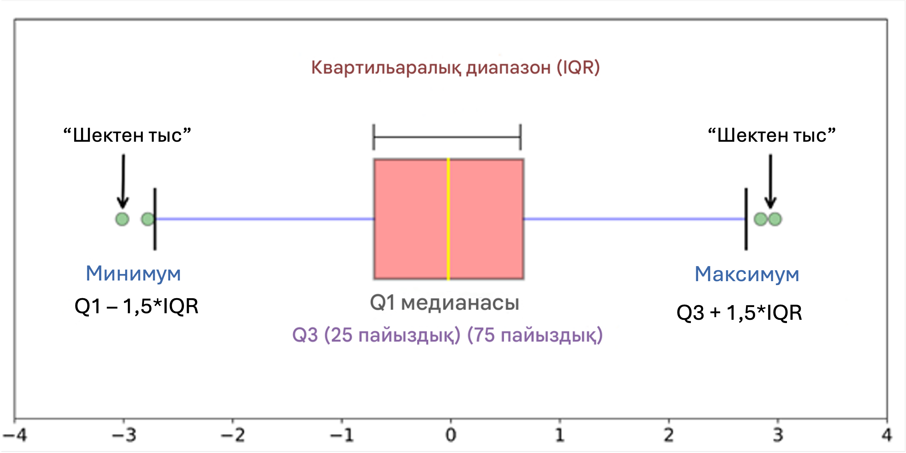
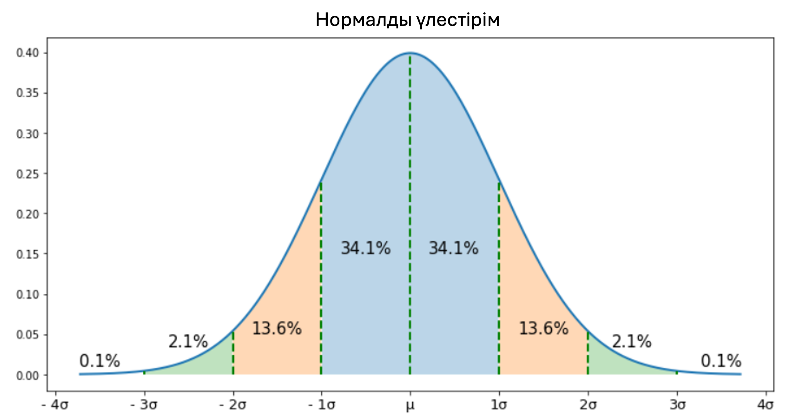

Адилхан Алматы қаласындағы Қазгидрометте аға метеоролог болып жұмыс істейді. Ол күнде өзінің тағылымдамашысы Дарханды мұздың тазалығын өлшеу үшін Т1-Тұйықсу метеорологиялық станциясына жіберіп тұрады. Т1-Тұйықсу станциясы қаладан алыс орналасқан және ол жерге жету шамамен екі сағатты алады. Осы себептен, Дархан ол жерге баруды ұнатпай, кейде жай ғана мұзды тоңазытқышынан алып, оның тазалығын метеорологиялық станцияның дерегі секілді тіркейтін. Осылай соңғы 12 ай бойы жалғасып келді. Бір күні Адилхан Дархан дайындаған деректер ішінен шектен тыс мәндерді байқап қалады. Дарханның алдап жүргенін түсініп, Адилхан Дарханды жұмыстан шығарады. Бір жылдық деректердің жоғалуын болдырмау мақсатында, Адилхан деректер жиынтығындағы шектен тыс мәндерді анықтап, оларды алып тастауды ойлайды. Өзі математиканы жетік білмейтіндіктен, шектен тыс мәндерді анықтауға арналған алгоритм жасауды сізден сұрайды.

Шектен тыс мәндерді анықтау — бұл мәліметтер жиынындағы басқа ақпараттардан айтарлықтай ерекшеленетін мәлімет нүктелерін айқындау процесі. Таңдаулар түрлі себептерге байланысты пайда болуы мүмкін. Мысалы: өлшеуіш қателері, ерекше жағдайлар немесе алаяқтық әрекеттер. Шектен тыс мәндерді анықтау өте маңызды міндет, себебі олар статистикалық талдауларды бұрмалап, машиналық оқыту модельдерінің жұмысын бұзуы мүмкін. Оларды айқындау және жою модель сапасын және болжамдардың дәлдігін арттыруға көмектеседі. Шектен тыс мәндерді анықтауға арналған кейбір танымал әдістерге Квартильаралық диапазон және Z-балл алгоритмдері жатады:

- Квартильаралық диапазон (IQR) әдісі: IQR мәліметтердің 75-ші (Q3) және 25-ші (Q1) процентильдерінің айырмашылығы ретінде есептеледі. Q1 — мәліметтер жиынының төменгі жартысының дәл ортасында орналасқан дерек нүктесі. Q3 — медиана мен мәліметтер жиынының соңы арасындағы ортаңғы нүкте. $\text{Q1} - 1.5 \times \text{IQR}$ және $\text{Q3} + 1.5 \times \text{IQR}$ аралығынан тыс орналасқан бақылаулар шектен тыс мәндер ретінде саналады.
- Z-балл әдісі: Бұл әдіс нормалды үлестірімге сәйкес келетін деректер үшін қолданылады. Таңдаулар орташа мәннен белгілі бір стандартты ауытқулар санынан (әдетте 2-3 стандартты ауытқу) артық ауытқитын бақылаулар ретінде анықталады.

 

Сіздің тапсырмаңыз квартильаралық диапазон (IQR) алгоритмін жүзеге асырып, шеткі мәндердің тізімін бір қатарға шығару.

**Енгізу форматы:**

Жол араларына бос орын қойылған $N$ мұз тазалық мәндерін қамтиды:

1.5 5 7.9 100000 -250999.67

**Шығару форматы:**

Жол араларына бос орын қойылған $K$ шеткі мәндерді қамтиды: 100000 -250999.67
