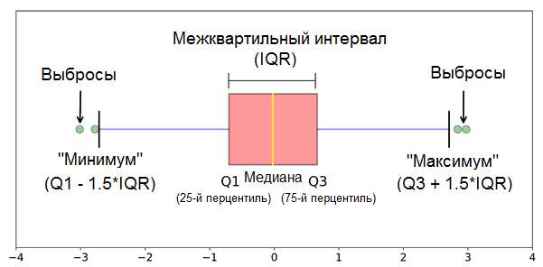
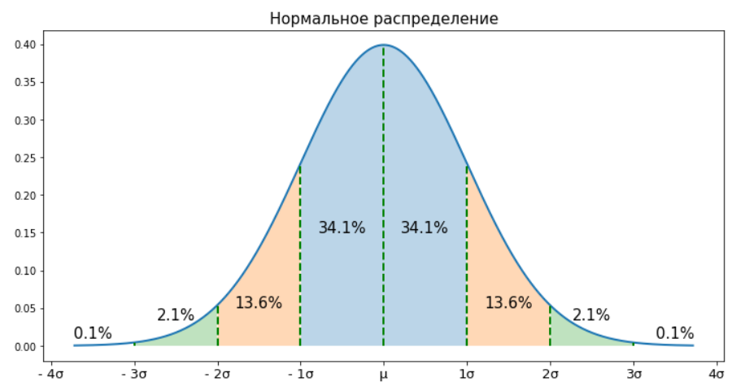

Старший метеоролог Адильхан работает в Казгидромете в Алматы. Он часто отправляет своего стажёра Дархана на метеостанцию Т1-Туюксу для измерения чистоты льда. Метеостанция Т1- Туюксу расположена далеко от города и добираться туда занимает около 2 часов. Из-за этого Дархан не любил ездить туда и иногда просто брал лёд из своего холодильника и записывал чистоту этого льда как показатель метеорологической станции. Это продолжалось на протяжении последних 12 месяцев. Однажды Адильхан заметил необычное значение чистоты льда в данных, предоставленных Дарханом. Когда Адильхан узнал об обмане, он уволил Дархана. Чтобы не потерять данные за прошедший год, Адильхан хочет выявить и удалить выбросы из набора данных. Поскольку он не разбирается в математике, он просит вас разработать алгоритм обнаружения выбросов.

Обнаружение выбросов (outlier detection) — это процесс идентификации данных, которые значимо отличаются от других наблюдений в наборе данных. Выбросы могут возникать по различным причинам, включая ошибки измерений, необычные события или мошеннические действия. Обнаружение выбросов является критически важной задачей, так как выбросы могут искажать статистические анализы и нарушать работу моделей машинного обучения. Их идентификация и удаление помогает повысить качество модели и точность предсказаний. Некоторые из популярных методов обнаружения выбросов включают:

- Метод межквартильного размаха (IQR). IQR вычисляется как разность между 75-м (Q3) и 25-м (Q1) процентилями данных. Q1 — это точка данных, расположенная ровно посередине нижней половины набора данных. Q3 — это точка на полпути от медианы до конца набора данных. Наблюдения, которые выходят за пределы $\text{Q1} - 1.5 \times \text{IQR}$ и $\text{Q3} + 1.5 \times \text{IQR}$, считаются выбросами.
- Метод Z-оценки. В этот метод используется для данных, которые следуют нормальному распределению. Выбросы определяются как наблюдения, которые отклоняются от среднего значения более чем на определенное количество стандартных отклонений (обычно 2-3 стандартных отклонения).

 

Ваша задача реализовать алгоритм межквартильного размах и вывести список выбросов одной строкой.

## Входной формат

Cтрочка содержит $N$ значении чистоты льда разделенные пробелом:

1.5 5 7.9 100000 -250999.67

## Выходной формат

Строчка c $K$ значениями выбросов разделенные пробелом:

100000 -250999.67
