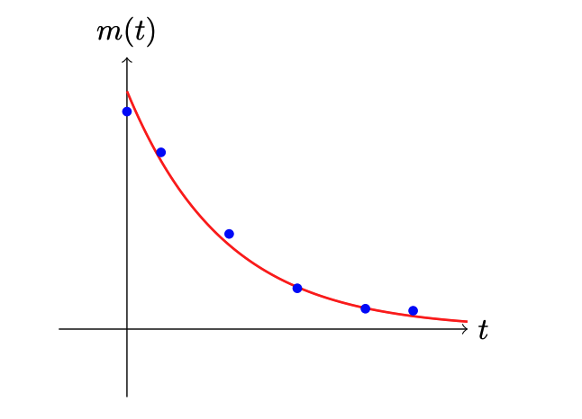
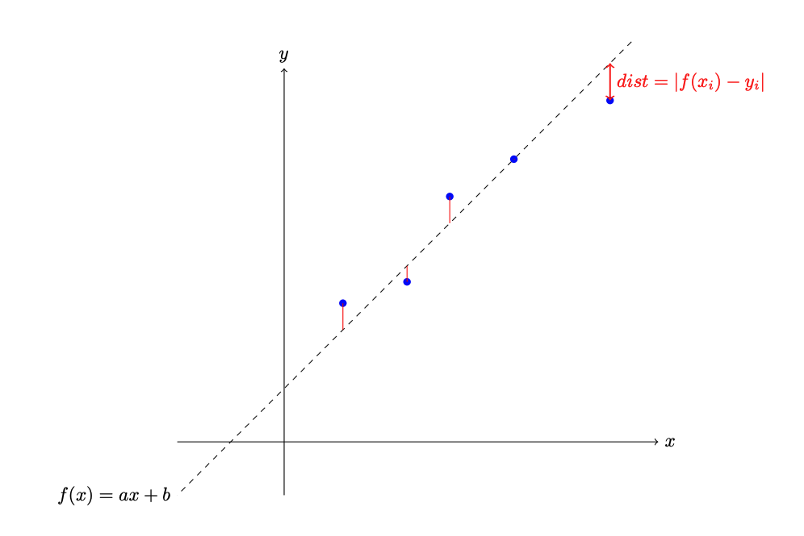

## Introduction

It is known in physics that a radioactive substance loses half of its activity (or mass) every $T_0$ seconds, which is described by the following equation:

$$m(t) = m_0 \left(\frac{1}{2}\right)^{t / T_0}$$

You are given the results of an experiment as $n$ pairs of values $t$ and $m(t)$. Your task is to determine the half-life $T_0$.



For this problem you may use various heuristic methods, or the classical method of linear regression after transforming the data into a convenient form.

## Linear Regression

Consider a dataset $\{(x_i, y_i)\}_{i=0}^n$ that has a linear dependency. We can model this relationship with a linear function $f(x) = ax + b$, where $a$ and $b$ are the model parameters describing the slope and the intercept respectively.



The parameters of the resulting linear function can be found by minimizing the mean squared deviation of each point from the line:

$$L(a, b) = \frac{1}{n}\sum_{i=0}^n\left(f(x_i) - y_i\right)^2 = \frac{1}{n}\sum_{i=0}^n\left(ax_i + b - y_i\right)^2 \rightarrow \min$$

Solving the equations $\frac{\partial}{\partial a}L(a, b) = 0$ and $\frac{\partial}{\partial b}L(a, b) = 0$ lets you determine the values of $a$ and $b$ analytically.

## Scoring

If your prediction is within 1% of the correct answer, you get 100 points; otherwise the result is 0. The final score is computed as the average of the scores over all test sets.

## Input format

$n$

$m_1$ $t_1$

$m_2$ $t_2$

...

$m_n$ $t_n$

### Description

$n$: the number of measurements.

$m_i$: the mass of the radioactive element (a real number) at time $t_i$ (a real number).

### Constraints

$1 < n \le 1000$

$1 < m_i \le 10000$

$1 \le t_i \le 5000$

### Example input

5

1000 0

500 10

250 20

125 30

62.5 40.0

In this example there are 5 measurements. The initial mass is 1000. The half-life is 10 seconds.

## Output format

$T_0$

### Example output

10.01

### Hint

It may be helpful to use the natural logarithm when solving this problem.

```
from math import log
```
