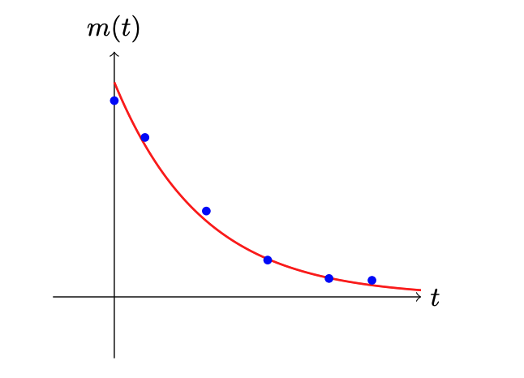
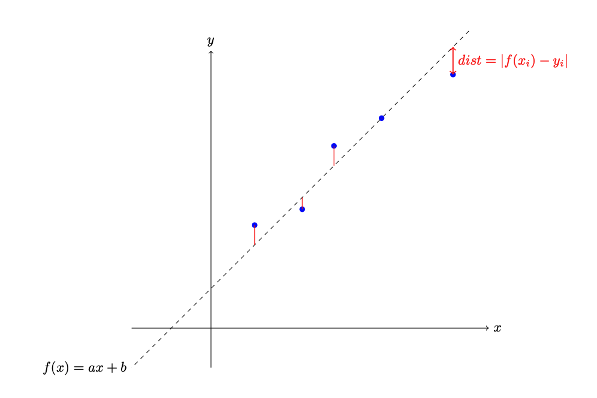

## Кіріспе

Физикадан белгілі болғандай, радиоактивті элементтер әр $T_0$ секунд сайын өз белсенділігінің (массасының) жартысын жоғалтады. Бұл процессті төмендегі теңдеумен сипаттауға болады:

$$m(t) = m_0 \left(\frac{1}{2}\right)^{t / T_0}$$

Сізге эксперимент нәтижелері берілген. Олар $n$ жұп $t$ уақыт пен $m(t)$ масса мәндерінен тұрады. Сіздің міндетіңіз – жартылай ыдырау кезеңін $T_0$ табу.



Бұл есепті шығару үшін әртүрлі эвристикалық әдістерді немесе мәліметтерді алдын ала түрлендіріп, классикалық сызықтық регрессия әдісін қолдануға болады.

## Сызықтық регрессия

Сызықтық тәуелділігі бар $\{(x_i, y_i)\}_{i=0}^n$ мәліметтер жиынтығын қарастырайық. Осы жиынтықтағы әрбір ($x_i$, $y_i$) жұпты сызықтық функция $y_i = ax_i+b$ арқылы сипаттай аламыз. Мұндағы $a$, $b$ белгісіз сызықтық функцияның параметрлері.



Сызықтық функцияның параметрлерін әр нүктенің түзуден орташа квадраттық ауытқуын минимизациялау арқылы анықтауға болады:

$$L(a, b) = \frac{1}{n}\sum_{i=0}^n\left(f(x_i) - y_i\right)^2 = \frac{1}{n}\sum_{i=0}^n\left(ax_i+b - y_i\right)^2 \rightarrow \min$$

$\frac{\partial}{\partial a}L(a, b) = 0$ және $\frac{\partial}{\partial b}L(a, b) = 0$ теңдеулерін шешу арқылы аналитикалық жолмен белгісіз мәндерді табуға болады.

## Бағалау критерийі

Егер сіздің болжамыңыз дұрыс жауаптың 1% шегінде болса, сіз 100 ұпай аласыз. Егер жіберілген болжам мен дұрыс жауаптың арасындағы қате 5% артық болса, онда 0 ұпай беріледі. Қорытынды балл барлық тест жиынтықтары үшін орташа балл ретінде есептеледі.

## Енгізу форматы

$n$

$m_1$ $t_1$

$m_2$ $t_2$

...

$m_n$ $t_n$

### Сипаттама

$n$: мәліметтер саны.

$m_i$: радиоактивті элементтің массасы (бүтін сан) $t_i$ уақыт мезетінде (бүтін сан).

### Шектеулер

$1 < n \le 1000$

$1 < m_i \le 10000$

$1 \le t_i \le 5000$

### Енгізу мысалы

5

1000 0

500 10

250 20

125 30

62.5 40.0

Бұл мысалда:

5 өлшеу берілген. Бастапқы масса 1000. Жартылай ыдырау кезеңі 10 секундты құрайды.

## Шығару форматы

$T_0$

### Шығару мысалы

10.01

### Кеңес

Бұл тапсырмада натурал логарифмді қолдану абзал:

```
from math import log
```
