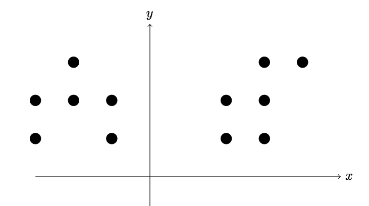
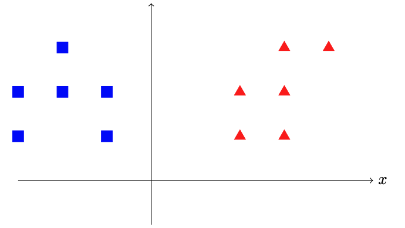

## Introduction

Clustering is the task of grouping a set of objects in such a way that objects in the same group (called a cluster) are more similar to each other than to those in other groups (clusters). It is a main task of exploratory data analysis, and a common technique for statistical data analysis, used in many fields, including pattern recognition, image analysis, information retrieval, bioinformatics, data compression, computer graphics and machine learning.

For example, here we have points in 2D plane without labels. We want to group them into cluster.

We can group them into 2 clusters:

We can formalize this task. Lets say we want to find $k$ clusters($S_1, \dots, S_k$), such that this objective function is minimal:

$$L = \frac{1}{n}\sum_{j=1}^{k}\sum_{\vec{r}_i \in S_j}|\vec{r_i} - \vec{\mu_j}|^2$$

Here, $$\vec{\mu_j} = \frac{1}{|S_j|}\sum_{\vec{r}\in S_j}\vec{r}$$

Considering all partitioning is expensive. We can solve this task by Kmeans algorithm.

1. Randomly choose $k$ centroids (centroid – center of a cluster).
2. For each point find closest centroid and mark it as point in that cluster.
3. Find for each cluster mean point ad assign it as new centroid.
4. Repeat 2-3 until converge.

Example:

Initial step: randomly chose 2 centroids

First iteration of Steps 2 and 3:

Second iteration of Steps 2 and 3:

## Metric

As a baseline solution we can solve this problem for $k=1$. It this case optimal cluster position will be mean positions of all points. Lets name loss function value in this case as $L_{baseline}$

We can measure performance of our model in scale from 0 to 1 by this formula:

$$m = \begin{cases} 0 & \text{if $L \geq L_{baseline}$} \\ 1 - L/L_{baseline} & \text{otherwise} \end{cases}$$

You task is implement kmeans algorithms. You will get 100 score if our model’s metric not less than our models 0.95 * metric, otherwise you will get 0.

## Input Format

$n$

$x_1$ $y_1$

$x_2$ $x_2$

...

$x_n$ $y_n$

$k$

$x_1$ $y_1$

...

$x_k$ $y_k$

### Descrioption

The first line contains $n$ number of points. Then follow $n$ lines:$x_i y_i$.

Then next line contains $k$ number of clusters. Then follow $k$ lines:$x_i y_i$ which is initial postions of centroids.

### Limits

$1 < n < 1000$

$1 < k < 10$

$1 < x_i, y_i < 50$

## Output Format

$x_1$ $y_1$

...

$x_k$ $y_k$

### Description

Final postions of your cluster after applying kmeans algorithm. Print $k$ line, $x_i y_i$ which is final postions of centroids.

$x_1$ $y_1$

...

$x_k$ $y_k$
