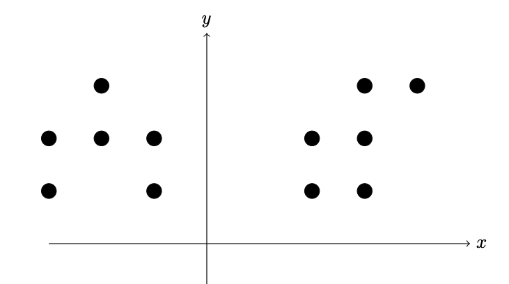
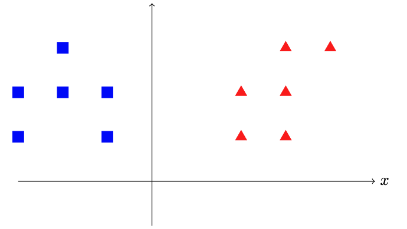

## Кіріспе

Кластерлеу-бұл бір топтағы объектілер (кластер деп аталады) басқа кластерлердегі объектілерге қарағанда бір-біріне ұқсас болатындай етіп объектілер жиынтығын топтастыру міндеті. Кластерлеу көптеген салаларда қолданылады, мысалы:

- Ақпарат іздеу: Ұқсас құжаттарды немесе веб-парақшаларды табу үшін.
- Биоинформатика: гендерді немесе ақуыздарды функциялары бойынша топтастыру.
- Аномалияларды анықтау: бұл үлкен суретке сәйкес келмейтін деректерді табуға көмектеседі.

Кластерлеудің алгоритм жұмысын қарапайым мысалды қарастырайық:

Мұнда нүктелердің екі кластерге бөліну мысалы көрсетілген.

## Kmeans

Бұл есепті формальды түрде анықтай аламыз. Келесі шығын функция азайтылатын $k$ кластерлерінің ($S_1, \dots, S_k$) тапқымыз келеді делік:

$$L = \frac{1}{n}\sum_{j=1}^{k}\sum_{\vec{r}_i \in S_j}|\vec{r_i} - \vec{\mu_j}|^2$$

мұндағы, $$\vec{\mu_j} = \frac{1}{|S_j|}\sum_{\vec{r}\in S_j}\vec{r}$$

$k$ кластерлеу алгоритмін қолдану арқылы $d$ өлшемді кеңістіктегі бақылауларды кластерлеудің оңтайлы шешімін табу:

1. Жалпы евклидтік кеңістікте (өлшемділігі $d$) екі кластер үшін де NP-қиын есеп.
2. Жалпы кластерлер саны $k$ үшін жазықтықта да NP-қиын есеп.
3. $k$ және $d$ (өлшемділігі) бекітілген кезде міндет $O(nd^{k+1})$ уақытында дәл шешілуі мүмкін, мұнда $n$ — кластерлеуге жататын нысандар саны.

Іс жүзінде кластерлеу үшін келесі итеративті алгоритм қолданылады:

1. $k$ центроидты кездейсоқ таңдаймыз (центроид — кластер ортасы).
2. Әрбір нүкте үшін ең жақын центроидты тауып, нүктені сәйкес кластерге жатқызамыз.
3. Әр кластер үшін орташа нүктені тауып, оны жаңа центроид ретінде белгілейміз.
4. 2 және 3 қадамдарды сәйкес нәтижеге жеткенше қайталаймыз.

Мысал:

Бастапқы қадам: 2 центроидты кездейсоқ таңдаймыз.

2 және 3 қадамдардың бірінші итерациясы:

2 және 3 қадамдардың екінші итерациясы:

## Метрика

Қарапайым шешім ретінде біз бұл мәселені $k=1$ үшін шеше аламыз. Бұл жағдайда кластердің оңтайлы орналасуы барлық нүктелердің орташа мәні болады. Мұндай жағдайда шығын функциясының мәнін $L_{baseline}$ деп атаймыз.

Моделіміздің қаншалықты жақсы жұмыс істейтінін бағалау үшін келесі формуланы қолдануға болады. Ол бізге 0 мен 1 арасында мән береді, мұндағы 1 — бұл тамаша нәтиже:

$$m = \begin{cases} 0 & \text{егер $L \geq L_{baseline}$} \\ 1 - L/L_{baseline} & \text{басқа жағдайда} \end{cases}$$

Сіздің міндетіңіз — K-means алгоритмін жүзеге асыру. Бастапқы центроидтарды таңдаудан туындайтын кездейсоқтық әсерін болдырмау үшін сізге бастапқы центроидтардың орналасуы беріледі.

Егер сіздің моделіңіздің метрикасы біздің моделіміздің метрикасының 0.95-ке көбейтіндісінен көп болса, сіз 100 ұпай аласыз, кері жағдайда сіз 0 ұпай аласыз.

Соңғы ұпай барлық тест жиынтықтары бойынша орташа ұпай болады.

## Енгізу форматы

$n$

$x_1$ $y_1$

$x_2$ $x_2$

...

$x_n$ $y_n$

$k$

$cx_1$ $cy_1$

...

$cx_k$ $cy_k$

### Сипаттама

$n$ - нүктелер саны.

$x_i, y_i$ - i-ші нүктенің координаттары.

$k$ - центроидтар саны.

$cx_i, cy_i$ - i-ші центроидтың координаттары.

### Шектеулер

$1 < n < 1000$

$1 < k < 10$

$1 < x_i, y_i, cx_i, cy_i < 50$

### Енгізу мысалы

5

-1 1

-1 2

-2 1

1 0

2 0

2

-2 2

3 0

## Шығару форматы

$cx_1$ $cy_1$

...

$cx_k$ $cy_k$

### Шығару мысалы

1.5 0

-1.5 1.3

### Сипаттама

K-means алгоритмін қолданғаннан кейінгі центроидтардың соңғы позициялары.
