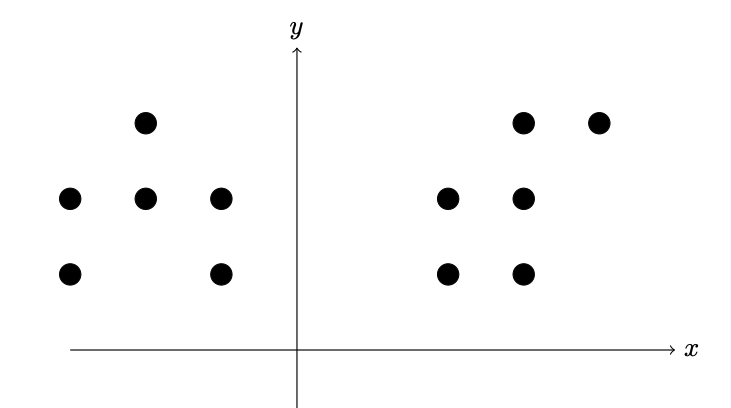
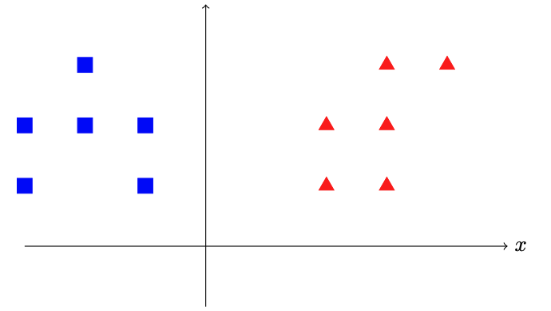

## Введение

Кластеризация — это задача группировки набора объектов таким образом, чтобы объекты в одной группе (называемой кластером) были более похожи друг на друга, чем на объекты в других группах (кластерах). Кластеризация используется во многих областях, например:

- Поиск информации: Чтобы находить похожие документы или веб-страницы.
- Биоинформатика: Чтобы группировать гены или белки по их функциям.
- Обнаружение аномалий: Она помогает найти данные, которые не вписываются в общую картину.

Рассмотрим простой пример кластеризации, чтобы наглядно продемонстрировать работу алгоритма на двумерных данных:

Тут показан пример, как точки разбиваются на два кластера.

## Kmeans

Мы можем формализовать эту задачу. Допустим, мы хотим найти k кластеров ($S_1, \dots, S_k$), таких, что минимизируется следующая целевая функция:

$$L = \frac{1}{n}\sum_{j=1}^{k}\sum_{\vec{r}_i \in S_j}|\vec{r_i} - \vec{\mu_j}|^2$$

где, $$\vec{\mu_j} = \frac{1}{|S_j|}\sum_{\vec{r}\in S_j}\vec{r}$$

Поиск оптимального решения задачи кластеризации K-means для наблюдений в $d$ измерениях является:

1. NP-трудной задачей в общем евклидовом пространстве (размерности $d$) даже для двух кластеров.
2. NP-трудной задачей для общего числа кластеров $k$ даже на плоскости.
3. при фиксированных $k$ и $d$ (размерности) задача может быть точно решена за время $O(nd^{k+1})$, где $n$ - число объектов, которые необходимо кластеризовать.

На практике для кластеризации используют следующий итеративный алгоритм:

1. Случайно выберем $k$ центроида (центроид – центр кластера).
2. Для каждой точки найдем ближайший центроид и отнесем точку к соответствующему кластеру.
3. Для каждого кластера найдем среднюю точку и назначим ее новым центроидом.
4. Повторяем шаги 2 и 3 до сходимости.

Пример:

Начальный шаг: случайно выберем 2 центроида.

Первая итерация шагов 2 и 3:

Вторая итерация шагов 2 и 3:

## Метрика

В качестве базового решения мы можем решить эту проблему для $k=1$. В этом случае оптимальное положение кластера будет средним положением всех точек. Назовем значение функции потерь в этом случае $L_{baseline}$.

Чтобы оценить, насколько хорошо работает наша модель, мы можем использовать следующую формулу. Она дает нам значение от 0 до 1, где 1 — это идеальный результат:

$$m = \begin{cases} 0 & \text{если $L \geq L_{baseline}$} \\ 1 - L/L_{baseline} & \text{иначе} \end{cases}$$

Ваша задача — реализовать алгоритм K-means. Для исключения влияния случайности, обусловленного выбором начальных центроидов, вам будут предоставлены заранее определенные координаты точек данных и начальные положения центроидов.

Вы получите 100 баллов, если метрика вашей модели не меньше, чем метрики нашей модели умноженное на 0.95, в противном случае вы получите 0.

Итоговый балл будет средним баллом по всем тестовым наборам.

## Формат ввода

$n$

$x_1$ $y_1$

$x_2$ $x_2$

...

$x_n$ $y_n$

$k$

$cx_1$ $cy_1$

...

$cx_k$ $cy_k$

### Описание

$n$ - число точек.

$x_i, y_i$ - координаты i-ый точки.

$k$ - количество центроидов.

$cx_i, cy_i$ - координаты i-го центроида.

### Ограничения

$1 < n < 1000$

$1 < k < 10$

$1 < x_i, y_i, cx_i, cy_i < 50$

### Пример ввода

5

-1 1

-1 2

-2 1

1 0

2 0

2

-2 2

3 0

## Формат вывода

$cx_1$ $cy_1$

...

$cx_k$ $cy_k$

### Пример вывода

1.5 0

-1.5 1.3

### Описание

Финальные позиции ваших центроидов после применения алгоритма K-means.
