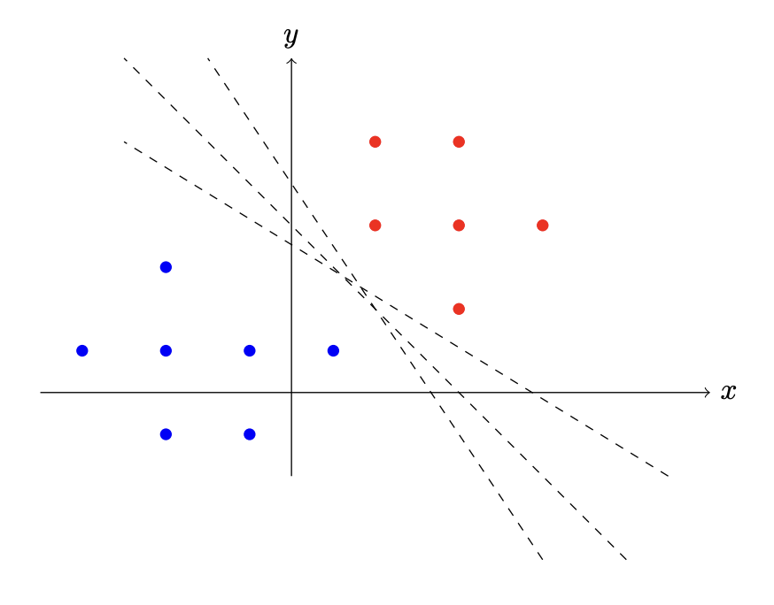
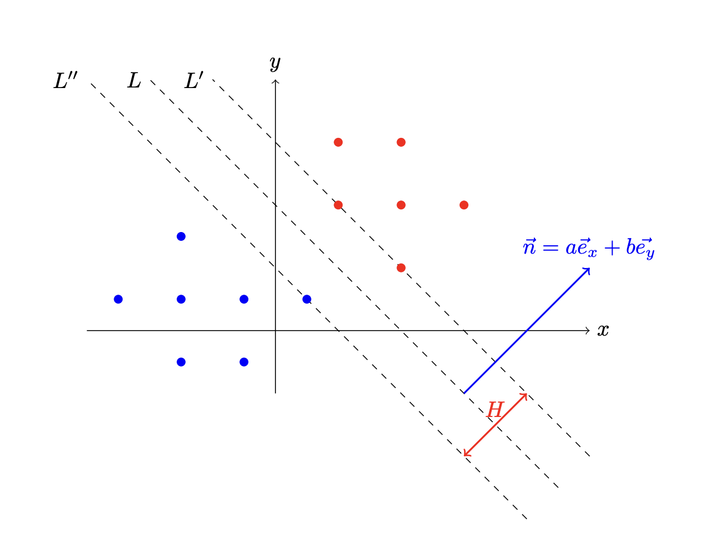

## Introduction

In machine learning, classification tasks often require algorithms that can accurately distinguish between different categories of data. Support Vector Machines (SVM) are a powerful family of linear classifiers designed for this purpose.

Let’s consider a dataset of $n$ points in a two-dimensional space, each belonging to one of two classes labeled as $l_i=\pm{1}$. We assume that these points can be perfectly separated by a hyperplane. Among all possible separating hyperplanes, we seek the one that maximizes the margin, which is the distance between the hyperplane and the nearest data points of both classes. This optimal hyperplane is defined by its support vectors.

## Classification Algorithm

Let the decision boundary, or hyperplane, be defined by the equation $ax + by + c = 0$. The parallel hyperplanes $L'$ and $L''$ at a distance $\delta$ from $L$ can be represented as $ax + by + c + \delta = 0$ and $ax + by + c - \delta = 0$, respectively. The distance between these parallel hyperplanes is:

$$H = \frac{2\delta}{\left|\vec{n}\right|}$$

To classify a new point $(x, y)$, we use the following decision rule:

$$a(x, y) = \begin{cases} +1 & \text{if $ax+by+c \geq 0$,} \\ -1 & \text{otherwise} \end{cases}$$

## Loss Function

We define a loss function to penalize misclassifications:

$$f(x, y, l) = \begin{cases} 0 & \text{if $a(x, y) = l$,} \\ \left|\vec{n}\right| d(L, x, y) & \text{otherwise} \end{cases}$$

Here, $d(L,x,y)$ represents the distance from the point $(x,y)$ to the hyperplane $L$.

To maximize the margin and minimize misclassifications, we introduce a loss function that combines both objectives:

$$Loss = \lambda {\left|\vec{n}\right|} ^2 + \frac{1}{k} \sum_{i=1}^{k}f(x_i, y_i, l_i)$$

The goal is to find the optimal values of $a,b,c$ that minimize the loss function. This can be achieved using gradient descent.

## Evaluation Metric

To evaluate the performance of the SVM model, we will measure the accuracy. Accuracy is defined as the proportion of correctly classified instances. And the score is defined as this formula:

$$score = \begin{cases} 0 & \text{accuracy < 0.90} \\ 100 \cdot \text{accuracy} & \text{otherwise} \end{cases}$$

The final score will be the minimum score across all test sets.

## Input Format

The first line contains $k$ number of points. Then follow $k$ lines: $x_i$ $y_i$ $l_i$.

Where $x_i$ $y_i$ is a coordinate of point $i$, and $l_i$ its label.

$10 < k < 4000$

$-100'000 < x_i, y_i < 100'000$.

Example:

10

2 6 -1

4 -8 1

9 -1 -1

5 2 -1

-9 7 -1

10 4 -1

2 -8 1

-6 -4 1

-10 -4 1

-2 8 -1

## Output Format

Print $a$ $b$ $c$ parameters of the line seperated by space.

Example:

1 1 0
