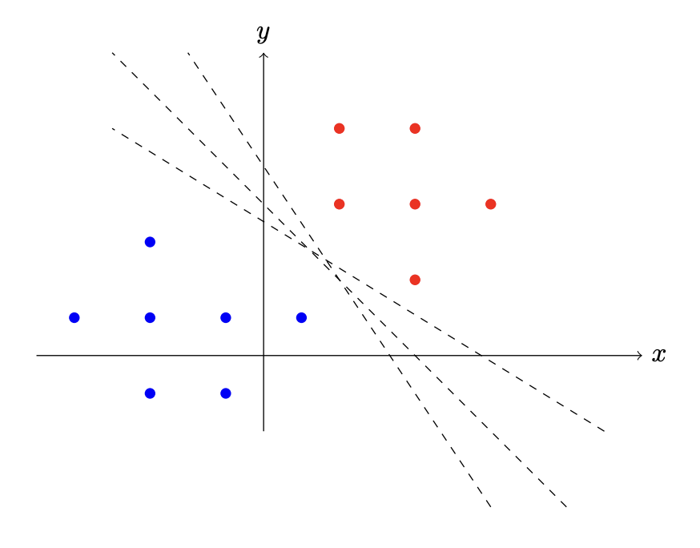
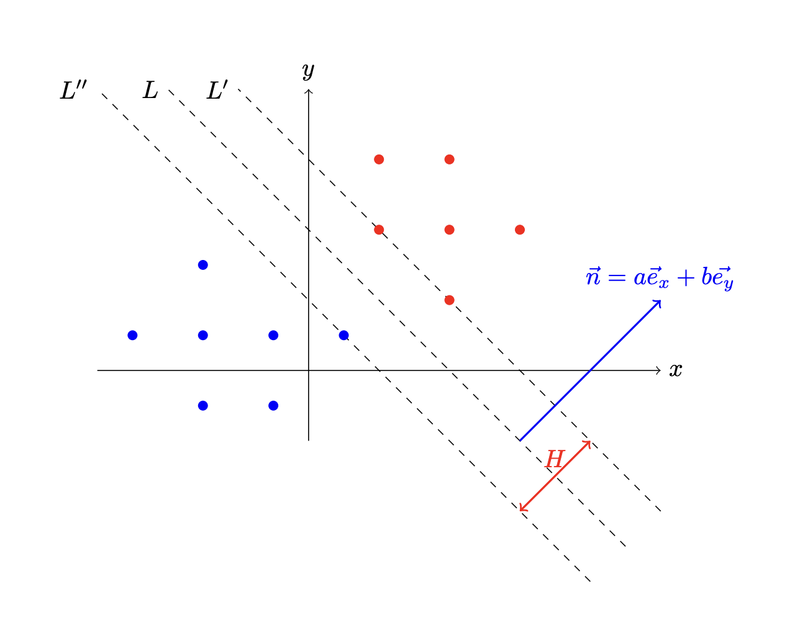

## Кіріспе

Көбінесе Machine Learning алгоритмдерінде деректерді жіктеу қажеттілігі туындайды. Бұл тапсырмада **Support vector machine** (SVM) жазу қажет, ол сызықтық классификаторлар тобына жатады.

Қарапайымдылық үшін $n$ нүктені екі өлшемді жазықтықта қарастырайық. Әрбір нүкте екі кластың біріне тиесілі және $l_i=\pm{1}$ деп белгіленеді. Нүктелерді бір жағында бір кластың нүктелері орналасатындай етіп түзу арқылы бөлуге болатынына кепілдік беріледі. Мұндай түзулердің саны көп болуы мүмкін, сондықтан біз $L$ түзуді іздейміз. Бұл түзу екі жақтағы ең жақын нүктелерден оның арақашықтықтарының қосындысын максималды ететін болады. Мұндай тәсіл сенімдірек жіктеуге мүмкіндік береді.

## Классификация алгоритмі

$L$ сызығы $ax + by + c = 0$ теңдеуімен берілсін. $L'$ және $L''$ сызықтары $L$-ге параллель болсын. Оларды $ax + by + c + \delta = 0$ және $ax + by + c - \delta = 0$ теңдеулері арқылы сипаттауға болады, мұнда $\delta>0$. $L'$ және $L''$ сызықтары арасындағы қашықтық:

$$H = \frac{2\delta}{\left|\vec{n}\right|}$$

$(x, y)$ нүктесін келесідей жіктейміз: $$a(x, y) = \begin{cases} +1 & \text{егер $ax+by+c \geq 0$,} \\ -1 & \text{әйтпесе} \end{cases}$$

## Жоғалту функциясы

Алгоритм қатесін келесі функциясы арқылы жазалаймыз:

$$f(x, y, l) = \begin{cases} 0 & \text{егер $a(x, y) = l$,} \\ \left|\vec{n}\right| d(L, x, y) & \text{әйтпесе} \end{cases}$$

Мұнда $d(L,x,y)$ координаталары $(x,y)$ нүктеден $L$ түзуіне дейінгі қашықтықты білдіреді.

Біз сондай-ақ $L'$ және $L''$ сызықтары арасындағы алшақтық мүмкіндігінше үлкен болғанын қалаймыз, сондықтан келесі жоғалту функциясын қарастырыңыз (алгоритмнің $\lambda$ гиперпараметрі өзіңіз таңдасаңыз болады):

$$Loss = \lambda {\left|\vec{n}\right|} ^2 + \frac{1}{k} \sum_{i=1}^{k}f(x_i, y_i, l_i)$$

Сіздің тапсырмаңыз $L$ түзу сызығының $a, b, c$ параметрлерін $Loss$-ды градиенттің түсуін арқылы табу.

## Метрика

Байқауда біз әр тест бойынша дұрыс жауаптардың үлесін (дәлдігін) өлшейміз және қорытынды көрсеткіш мына формуламен анықталады:

$$score = \begin{cases} 0 & \text{дәлдік < 0.97} \\ 100 \cdot \text{дәлдік} & \text{әйтпесе} \end{cases}$$

Қорытынды балл барлық сынақ жинақтарының орташа мәні болады.

## Енгізу пішімі

$k$

$x_1$ $y_1$ $l_1$

$x_2$ $y_2$ $l_2$

...

$x_k$ $y_k$ $l_k$

### Сипаттама

$k$ - ұпай саны.

$x_i, y_i$ - i-ші нүктенің координаталары

$l_i$ - i-ші нүктенің класы

### Шектеулер

$1000 < k < 4000$

$-100000 < x_i, y_i < 100000$

### Енгізу мысалы

10

2 6 -1

4 -8 1

9 -1 -1

5 2 -1

-9 7 -1

10 4 -1

2 -8 1

-6 -4 1

-10 -4 1

-2 8 -1

## Шығару пішімі

$a$ $b$ $c$

### Мысалы шығыс

1 1 0
